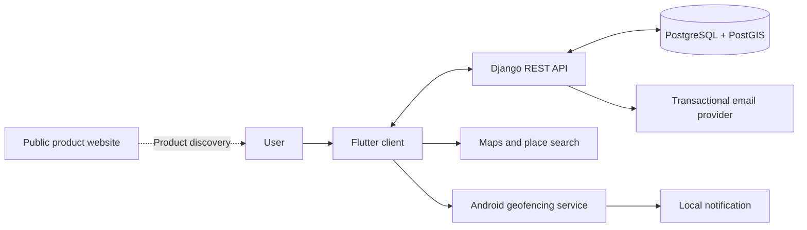

# System architecture

GeoNote separates the mobile experience, server-side application state, and device-managed background location events.

This is a **logical architecture**, not a disclosure of production infrastructure topology.

## Mobile client

Flutter provides the application screens, map interactions, authentication flow, and reminder management. Android-specific location monitoring uses the platform geofencing service. The operating system can generate entry events without requiring a continuously running Flutter stream.

A device-local snapshot of eligible reminders supports monitoring after synchronization. Alert delivery depends on platform permissions, battery policies, and actual geofence behavior. The supported Android implementation applies cooldown and re-entry safeguards, with a bounded number of monitored reminders.

## API and domain

Django and Django REST Framework handle identity, reminders, visibility, sharing, discovery, and moderation. The mobile API uses the `/api/v1/` contract so future backend changes can be reviewed for compatibility with previously installed clients.

Core domain concepts include:

- **Account:** user identity and access lifecycle.
- **Reminder:** content, place, geographic radius, active state, and visibility.
- **Shared reminder:** copy/provenance and sharing semantics.
- **Discovery:** location-aware filtering of eligible public reminders.
- **Moderation:** reports, enforcement decisions, and audit history.

The mobile device and backend have different responsibilities. The server persists reminder location data and supports geographic queries; background entry detection and the associated local notification occur on the Android device. That distinction is important when discussing privacy and offline behavior.

## Persistence

PostgreSQL stores account and reminder state. PostGIS supports geospatial operations for place-aware features, including nearby public discovery. Data access is constrained by the reminder's visibility and the operation's authorization rules.

## Delivery and observability

The implementation repository contains GitHub Actions workflows for backend checks and Flutter builds/tests, along with a protected Android release path. The backend includes structured logs, request correlation, and HTTP metrics support.

Specific deployment configuration, internal endpoints, credentials, and operations details are intentionally excluded from this public overview.

[Back to overview](../README.md) · [Engineering decisions](engineering.md)
